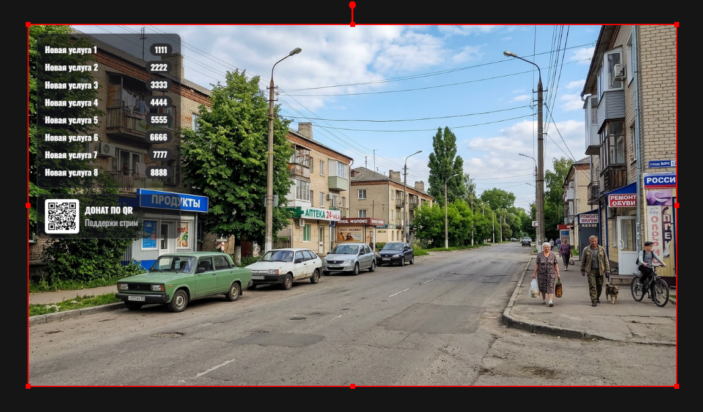
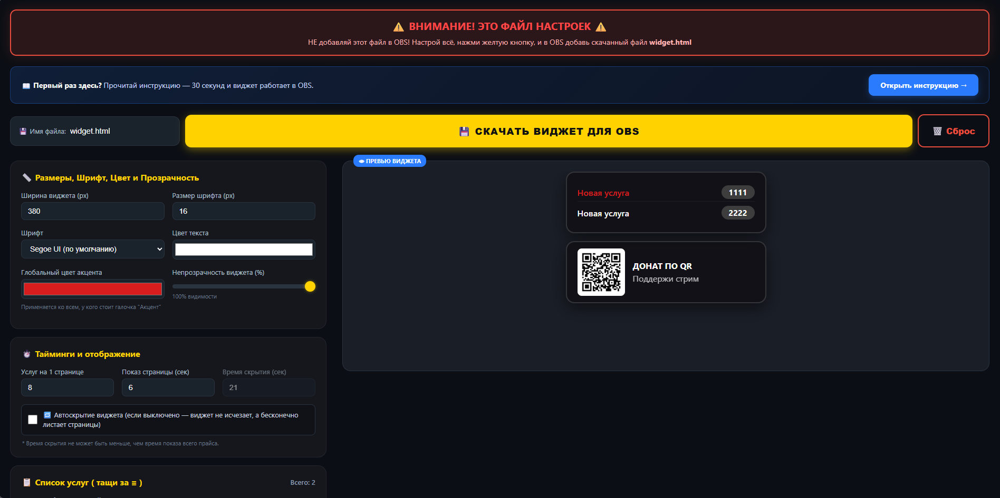
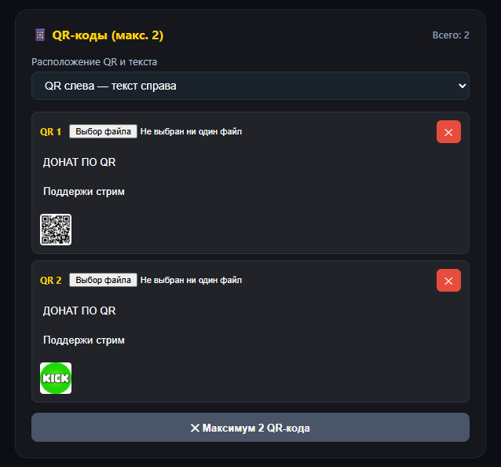
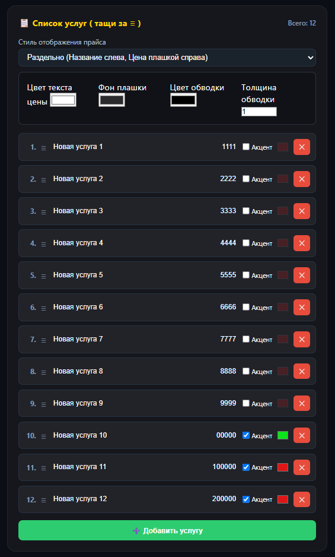

# 🎯 OBS Price Widget

Красивый виджет-прайс для OBS: список услуг с автопрокруткой, автоскрытием и QR-кодом доната. Полностью локально, без серверов и аккаунтов.

## 🚀 Быстрый старт

### 1. Открой онлайн-настройщик
👉 **[Открыть настройщик](https://dari1925.github.io/obs-widget/)**

Настрой всё в браузере — справа живое превью, обновляется мгновенно.

### 2. Скачай виджет
Нажми **«💾 СКАЧАТЬ ВИДЖЕТ ДЛЯ OBS»** — получишь файл `widget.html`.

### 3. Добавь в OBS
1. Источники → **+** → **Браузер**
2. ✅ Галочка **«Локальный файл»**
3. Выбери `widget.html`
4. Ширина ~400, высота ~600

⚠️ **Не добавляй в OBS файл настроек** — он только для настройки.

📖 **[Подробная инструкция со скриншотами](https://DaRi1925.github.io/obs-price-widget/instruction.html)**

## ⚙️ Возможности

- ✅ **Живое превью** — видно результат до скачивания
- ✅ **8 шрифтов** + цвет текста, акцента и цены
- ✅ **2 стиля прайса** — в строку или с плашкой справа
- ✅ **Автопрокрутка** страниц с настраиваемым интервалом
- ✅ **Автоскрытие** — виджет появляется, крутит прайс, скрывается и возвращается
- ✅ **До 2 QR-кодов** — горизонтально или вертикально
- ✅ **Сохранение настроек** в браузере (localStorage)
- ✅ **Полностью локально** — никаких серверов, аккаунтов, трекинга
- ✅ **Адаптивно** — работает в любом современном браузере

## 📸 Скриншоты

| Настройки | QR-коды |
|-----------|---------|
|  |  |

| Список услуг | Результат в OBS |
|--------------|-----------------|
|  |  |

## 🖥️ Требования

- **Для настройки:** любой современный браузер (Chrome, Edge, Firefox, Safari)
- **Для OBS:** OBS Studio 28+ (любая версия с источником «Браузер»)

## 🛠️ Как это работает

1. Файл `index.html` — редактор виджета. В нём вся логика настройки, превью и экспорта.
2. Настройки хранятся в `localStorage` браузера — закрой вкладку, вернись позже, всё на месте.
3. При скачивании генерируется автономный `widget.html` — внутри уже все данные, CSS и JS. OBS читает его как локальный файл, никакой интернет не нужен (кроме подгрузки шрифтов Google Fonts).

## 🐛 Известные ограничения

- Шрифты подгружаются с Google Fonts — без интернета виджет покажет системный шрифт.
- Размер QR-картинки — до **1 МБ** (защита от переполнения localStorage).
- Максимум **500 услуг** и **2 QR-кода**.
- Настройки привязаны к конкретному браузеру и домену.

## 💡 Советы

- **Хочешь несколько виджетов?** Скачай файл под разными именами (`donate.html`, `games.html`) и добавь как два источника в OBS.
- **Не хочешь, чтобы виджет кушал CPU в фоне?** В свойствах источника в OBS включи «Обновить, когда сцена активна».
- **Кириллица в пути к файлу?** Иногда OBS спотыкается. Положи виджет в `C:\widget\widget.html` — работает стабильнее.

## 📄 Лицензия

[MIT](LICENSE) © 2024 DaRi1925

Используй, форкай, меняй — без ограничений. Только сохрани копирайт.

## 🙏 Благодарности

- [Google Fonts](https://fonts.google.com/) — за набор шрифтов
- [OBS Studio](https://obsproject.com/) — за источник «Браузер»

---

**Нашёл баг или есть идея?** Открой [issue](https://github.com/DaRi1925/obs-price-widget/issues) — буду рад.
